# Penumbra

**A mobile-first Linux desktop environment, shell, and Wayland compositor for phones, written in Rust.**

[](https://www.rust-lang.org/)
[](#license)
[](https://discord.gg/W6d2ssYN2m)
[](https://matrix.to/#/#penumbra-shell:matrix.org)
[](https://t.me/+X4aVNAk9bEM4ZTU0)

Penumbra is an open-source mobile desktop environment for Linux phones. It provides a touch-first home screen, app drawer, status bar, navigation gestures, notifications shade, quick settings panel, on-screen keyboard, display manager greeter, and settings application, running ordinary Linux applications alongside them. It is built in [Rust](https://www.rust-lang.org/) using the [Smithay](https://smithay.github.io/) Wayland compositor library and the [Slint](https://slint.dev/) declarative UI toolkit.

> **Status: early development.** Penumbra runs daily on the maintainer's phone (Fairphone 4 on postmarketOS) but is actively evolving. Expect rapid progress and continuous improvements.

---

## Screenshots

<div align="center">

### Core Shell & Homescreen
| Greeter / Login | Lock Screen | Home Screen | Open Folder |
|:---:|:---:|:---:|:---:|
| 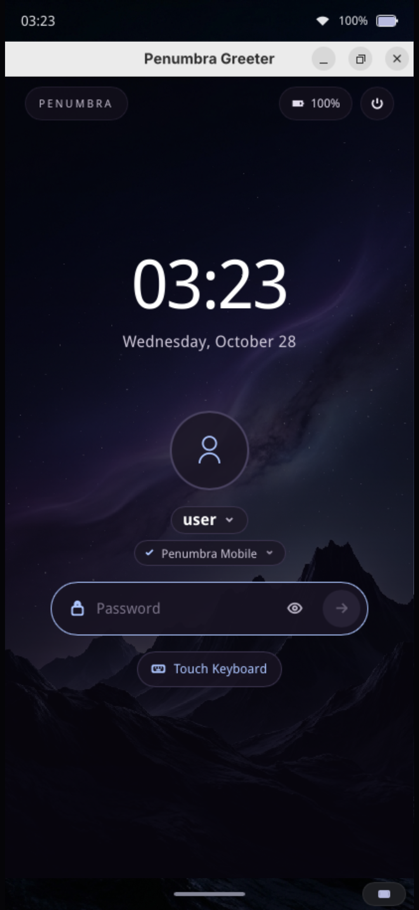 | 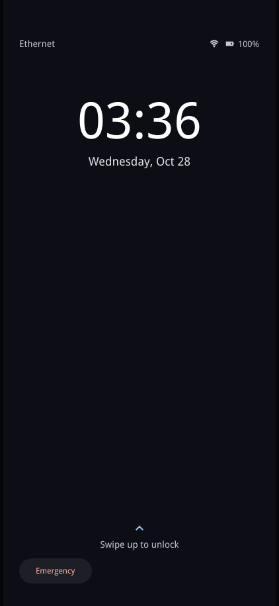 | 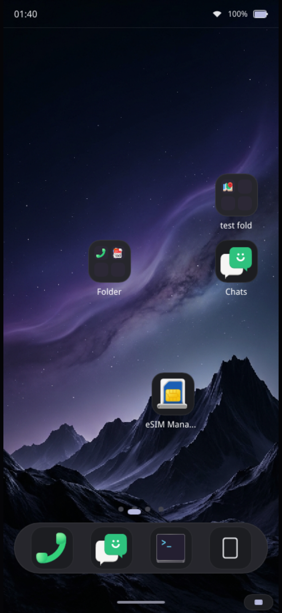 | 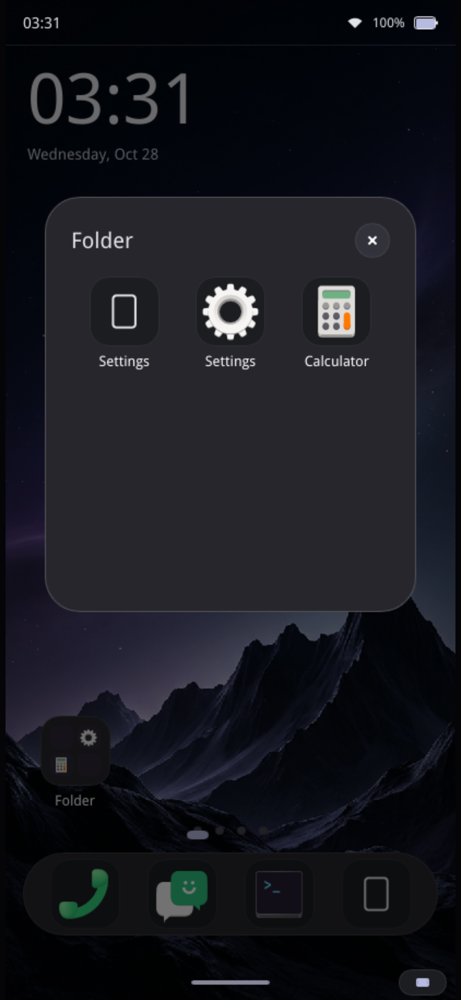 |

### App Navigation & Virtual Keyboard
| App Drawer | On-Screen Keyboard | Quick Settings | Notifications & Media |
|:---:|:---:|:---:|:---:|
| 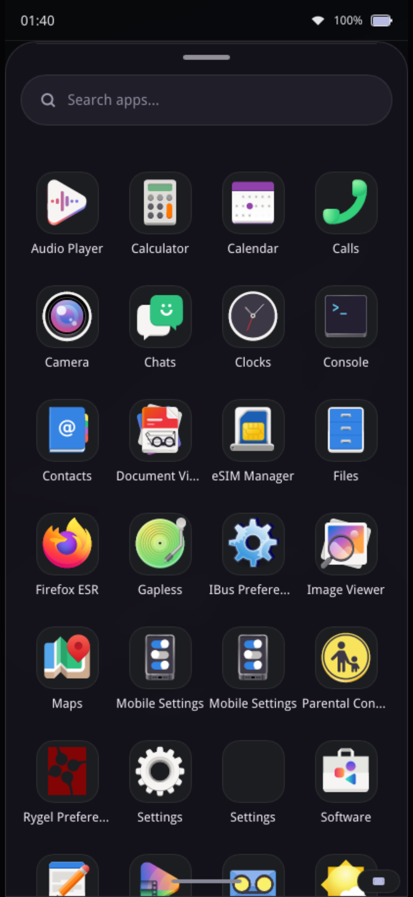 | 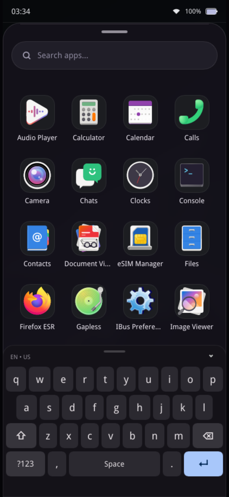 | 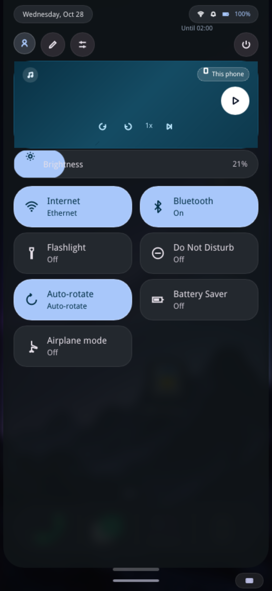 | 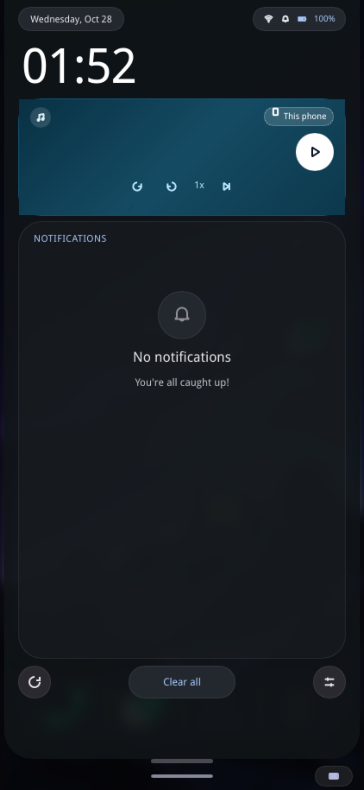 |

### System Controls & Dialogs
| Volume HUD | Power Menu | Settings Main | About Phone |
|:---:|:---:|:---:|:---:|
| 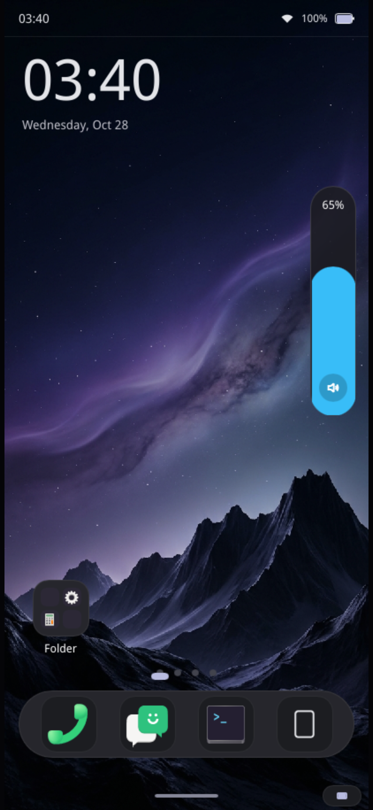 | 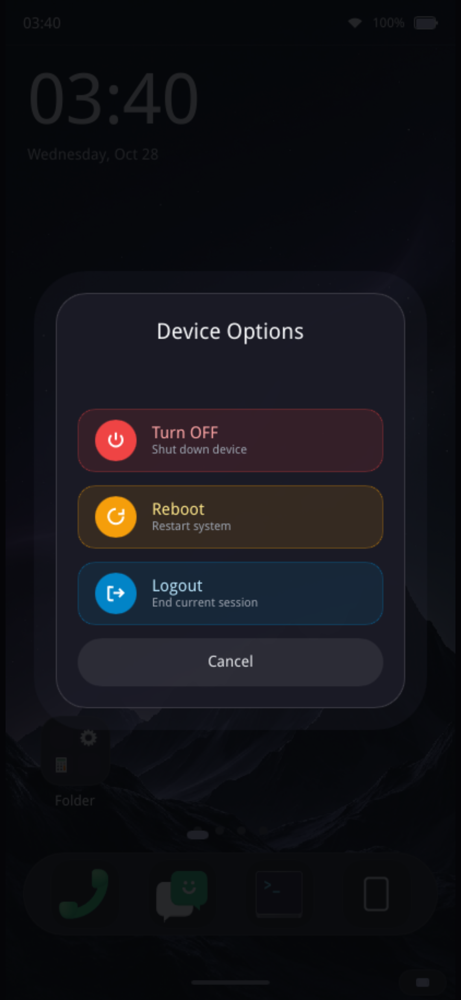 | 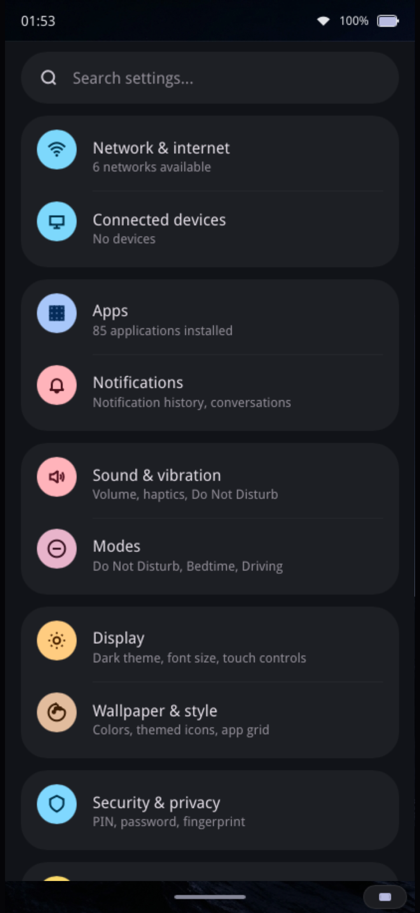 | 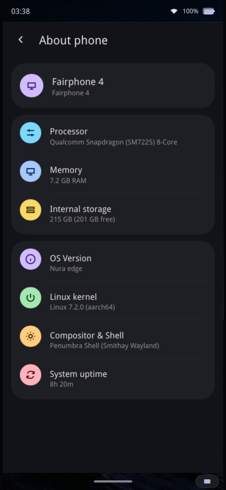 |

### Hardware Settings Subpages
| Wi-Fi & Networks | Display & Theme | Battery & Power | Physical Hardware |
|:---:|:---:|:---:|:---:|
| 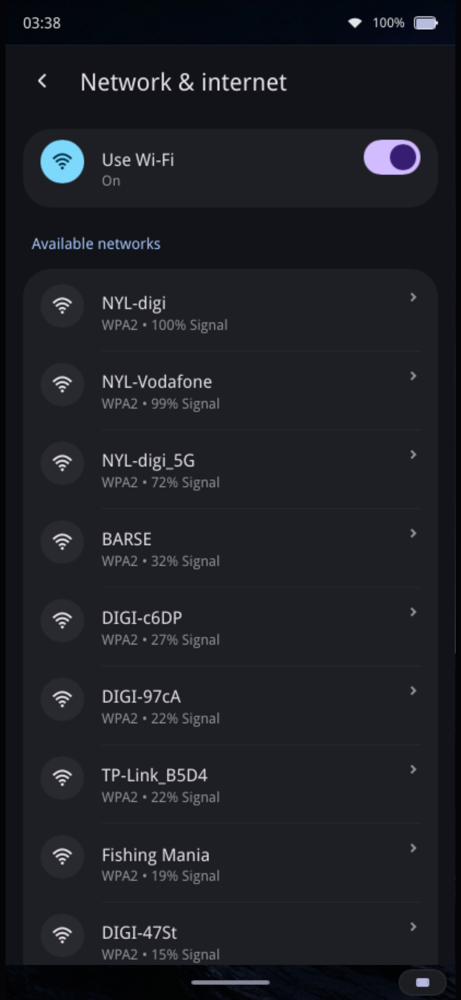 | 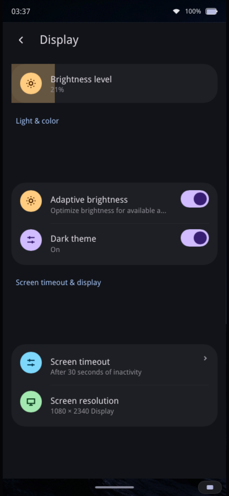 | 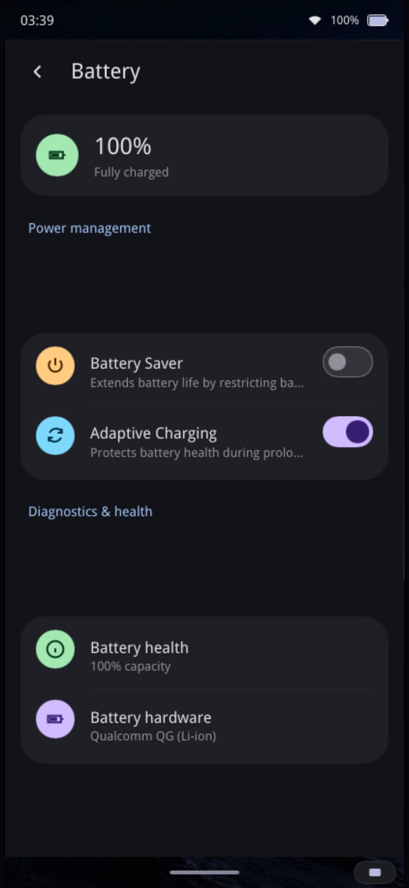 |  |

</div>

---

## Features

### Material 3 Expressive SystemUI
- **Dual-Mode Split Shade**: Pull down from the top-left edge to open **Notifications & Media**, or pull down from the top-right edge to open **Quick Settings**.
- **Lateral Swipe Navigation**: Fluid horizontal swipe gesture to glide between Notifications and Quick Settings views.
- **Flush Edge & Floating Status Pills**: Shade cards start flush against the top screen bezel, framed by rounded status pills for time, battery percentage, charging state, and network connectivity.
- **M3 Expressive Slates**: Two-column Quick Settings grid with active blue pastilles, contextual sublabels, and automatic marquee scrolling for long text.
- **Integrated Controls**: Touch-friendly brightness slider, volume modal with system sync, MPRIS media playback controls, and power dialog.

### Home Screen & App Organization
- **Consistent Mobile Proportions**: 64px continuous squircles with 18px radii, 84% icon scaling, and 13px medium typography matching modern Android proportions.
- **Multi-Page Workspace**: Smooth touch swiping across customizable app grid pages with an animated worm page indicator.
- **At a Glance Widget**: Live clock, date, and weather info prominently displayed on the primary home page.
- **Persistent Bottom Dock**: High-contrast 76px dock pastille for fast access to favorite applications.
- **Drag-and-Drop Management**: Long-press icons to drag across pages, drop an icon onto another to create a folder with 2×2 live previews, or tap the delete badge in edit mode to remove shortcuts.

### App Drawer & Real-Time Search
- **Obsidian Frosted Glass**: Translucent drawer container (`#14121be8`) with 32px top radius, 1.5px subtle border, and top specular refraction sheen.
- **Centered 4-Column Grid**: Symmetrically aligned with the search pill for balanced, ergonomic thumb reach.
- **In-Memory Search**: Instant app filtering indexed directly from system `.desktop` files with clear button and on-screen keyboard trigger.
- **Android 1:1 Kinetic Scrolling**: Exponential deceleration friction (`0.92`), interruptible inertia glide, and seamless top-of-list downward grab gestures.

### Native Mobile Settings (`penumbra-settings`)
- **First-Class Mobile Experience**: Standalone native settings app built with grouped Material 3 cards.
- **Settings Categories**: Network & Internet, Connected Devices (Bluetooth), Apps, Notifications, Sound & Vibration, Display (Dark theme), Wallpaper & Style, Security & Privacy, and Virtual Keyboard configuration.
- **Single-Instance D-Bus Service**: Instant navigation to specific subpages via D-Bus activation or Quick Settings shortcuts.

### Display Manager Greeter & Lockscreen (`penumbra-greeter`)
- **Greetd Login Frontend**: Clean mobile greeter compatible with `greetd` for mobile display manager login.
- **Network Timezone Detection**: Automatic local timezone discovery and synchronization over cellular modem or Wi-Fi.
- **Lockscreen Security**: Integrated layer-shell lockscreen with swipe-up challenge, PIN pad keypad, password entry, and biometric fingerprint authentication.

### GPU Progressive Blur & Color Diffusion
- **Multi-Pass Dual-Kawase Pipeline**: 5-pass ping-pong blur with an isotropic 9-tap kernel running in OpenGL ES directly on offscreen framebuffers.
- **Dynamic Color Diffusion**: Color saturation and chromatic highlights diffuse outwards proportionally to gesture progress.
- **High Performance**: Sub-0.4ms GPU pass execution, preserving rock-solid 60/120 FPS on Qualcomm Adreno GPUs.

### Wayland Virtual Keyboard (`penumbra-keyboard`)
- Built-in on-screen keyboard supporting `zwp_input_method_v2` and `virtual-keyboard-v1`.
- Fast layer-shell overlay with multiple layouts, auto-capitalization, and numeric modes.

---

## Architecture

Penumbra is designed as a modular suite of focused Rust crates:

| Crate | Purpose |
|---|---|
| [`penumbra-comp`](crates/penumbra-comp) | Wayland compositor powered by Smithay. Enforces phone display policy, manages window lifecycles, and executes the progressive Dual-Kawase blur pipeline. |
| [`penumbra-shell`](crates/penumbra-shell) | Touch interface: home screen, app drawer, status bar, navigation bar, notifications shade, and quick settings panel built with Slint. |
| [`penumbra-gestures`](crates/penumbra-gestures) | Physics-driven touch trackers, spring solvers, and multi-zone gesture arbitration. |
| [`penumbra-services`](crates/penumbra-services) | System telemetry services interfacing with D-Bus (UPower, NetworkManager, SensorProxy, MPRIS). |
| [`penumbra-keyboard`](crates/penumbra-keyboard) | Built-in on-screen keyboard and supervisor for 3rd-party Wayland virtual keyboards. |
| [`penumbra-settings`](crates/penumbra-settings) | Standalone native mobile Settings app with search, network, bluetooth, and display controls. |
| [`penumbra-greeter`](crates/penumbra-greeter) | Mobile display manager login screen frontend compatible with `greetd`. |
| [`layer-shell-slint`](crates/layer-shell-slint) | Wayland `wlr-layer-shell` backend integration bridge for Slint with full keyboard protocol support. |

---

## Requirements

- Linux with Wayland support (DRM/KMS on hardware, or nested within an existing Wayland session for desktop testing)
- Rust (stable, 2021 edition), installed via [rustup](https://rustup.rs/)
- System development libraries for your distribution:

**Ubuntu / Debian / Pop!_OS**
```bash
sudo apt update
sudo apt install -y build-essential pkg-config libwayland-dev \
    libwayland-egl-backend-dev libxkbcommon-dev libfontconfig1-dev \
    libgl1-mesa-dev libegl1-mesa-dev libdbus-1-dev libinput-dev
```

**Fedora / RHEL**
```bash
sudo dnf install -y gcc gcc-c++ pkgconf-pkg-config wayland-devel \
    libxkbcommon-devel fontconfig-devel mesa-libGL-devel \
    mesa-libEGL-devel dbus-devel libinput-devel
```

**Arch Linux**
```bash
sudo pacman -S --needed base-devel pkgconf wayland libxkbcommon fontconfig mesa dbus libinput
```

---

## Getting Started

### 1. Clone the repository
```bash
git clone https://github.com/penumbra-mobile/penumbra-env.git
cd penumbra-env
```

### 2. Build the workspace
```bash
cargo build --workspace
```

### 3. Run nested on your desktop
```bash
./run_penumbra.sh
```
This launches `penumbra-comp` nested inside a Wayland window at phone resolution ($412 \times 915$) and starts the full SystemUI shell inside it.

### 4. Run the test suite
```bash
cargo test --workspace
```

---

## Running on Hardware

Penumbra targets ARM64 Linux phones (tested daily on postmarketOS / Alpine Linux on Fairphone 4). 

The automated deployment script handles cross-compilation in Docker and SSH staging:

```bash
# Build ARM64 release binaries and deploy to phone
DEVICE_PASSWORD=1 ./scripts/deploy.sh --build

# Deploy existing release build without recompiling
DEVICE_PASSWORD=1 ./scripts/deploy.sh

# Deploy without restarting the session
DEVICE_PASSWORD=1 ./scripts/deploy.sh --no-restart

# Check phone connection and running status
./scripts/deploy.sh --status
```

Options can be customized via CLI flags (e.g., `--ip 172.16.42.1 --user user`) or environment variables (`DEVICE_IP`, `DEVICE_PASSWORD`, `SUDO_PASSWORD`).

---

## Configuration

- Home screen layout, dock slots, app positions, and folders are saved to `~/.config/penumbra/layout.json`.
- Quick settings tile layout and enabled toggles are saved to `~/.config/penumbra/quick_settings.json`.
- Virtual keyboard preferences are saved to `~/.config/penumbra/keyboard.conf`.
- Security lock type, PIN, and biometric settings are stored in `~/.config/penumbra/security.json`.

---

## Community & Contact

Join our community to chat about development, report issues, or get help running Penumbra:

- **Discord**: [Join the Discord server](https://discord.gg/W6d2ssYN2m)
- **Matrix**: [#penumbra-shell:matrix.org](https://matrix.to/#/#penumbra-shell:matrix.org)
- **Telegram**: [Penumbra Mobile Telegram Group](https://t.me/+X4aVNAk9bEM4ZTU0)

---

## Contributing

Bug reports, suggestions, and pull requests are warmly welcome! Please open an issue to discuss proposed changes before opening large PRs.

---

## License

Penumbra is dual-licensed under either:

- Apache License, Version 2.0 ([LICENSE-APACHE](LICENSE-APACHE))
- MIT license ([LICENSE-MIT](LICENSE-MIT))

at your option.
