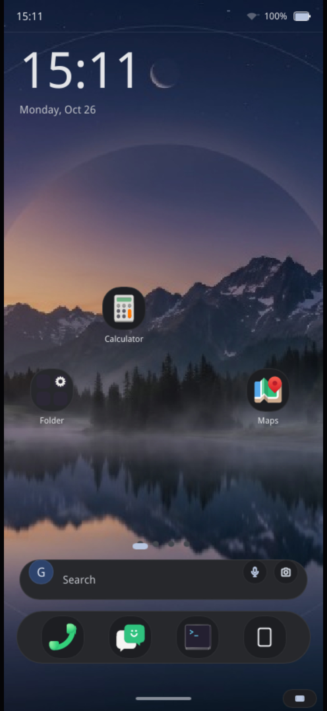
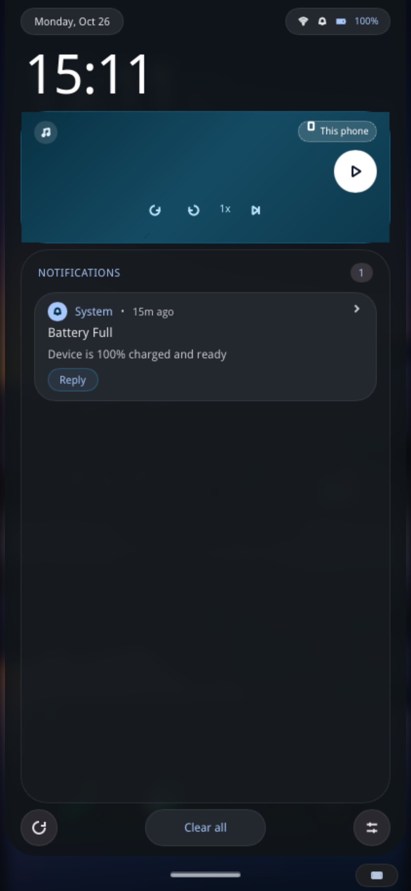
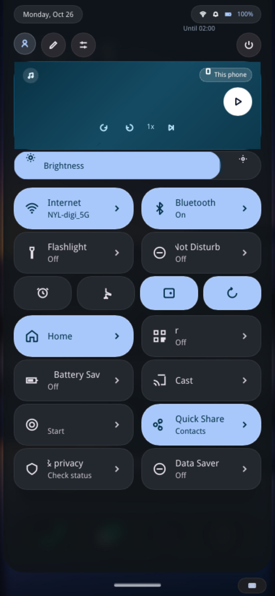
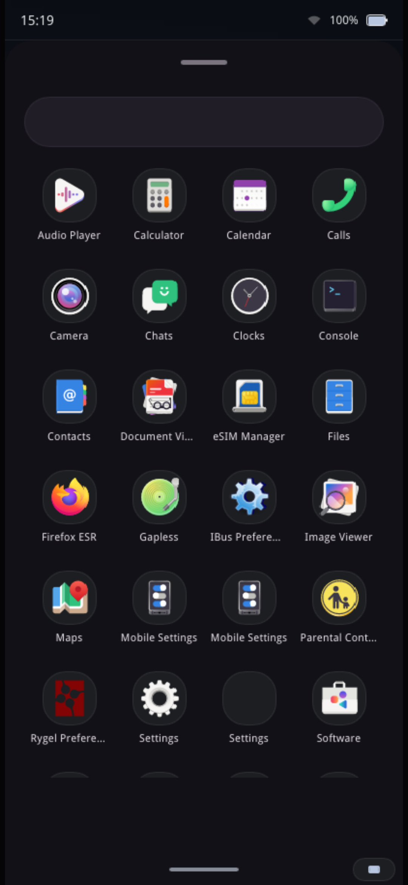
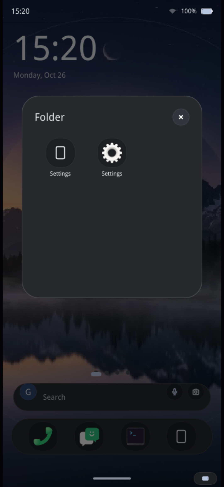

# Penumbra

**A mobile-first Linux home screen and Wayland compositor for phones, written in Rust.**

[](https://www.rust-lang.org/)
[](#license)

Penumbra is an open-source mobile desktop environment for Linux phones. It provides a touch-first home screen, app drawer, status bar, navigation gestures, notifications shade, and quick settings panel, running ordinary Linux applications alongside them. It is built with [Rust](https://www.rust-lang.org/), the [Smithay](https://smithay.github.io/) Wayland library, and the [Slint](https://slint.dev/) UI toolkit.

> **Status: early development.** Penumbra runs daily on the maintainer's phone (Fairphone 4 on postmarketOS) but is not yet ready for general use. Expect rough edges and active development.

## Screenshots

<div align="center">

| Home screen | Notifications | Quick settings | App drawer | Folder |
|:---:|:---:|:---:|:---:|:---:|
|  |  |  |  |  |

<br>

**Running on a real Linux phone (Fairphone 4)**


</div>

## Features

### Material 3 Expressive SystemUI
- **Dual-Mode Split Shade**: Pull down from the top-left edge to open **Notifications & Media**, or pull down from the top-right edge to open **Quick Settings**.
- **Lateral Swipe Navigation**: Smooth horizontal swipe gesture to fluidly glide between Notifications and Quick Settings views.
- **Flush Edge & Floating Status Pills**: Shade cards start flush against the top screen bezel, framed by rounded status pills for time, battery, Wi-Fi, and status indicators.
- **M3 Expressive Slates**: Two-column quick settings grid with active states, contextual sublabels, and automatic marquee scrolling for overflowing text.
- **Integrated Sliders & Controls**: Touch-friendly brightness slider, volume modal with system sync, media playback controls (MPRIS), and power dialog.

### GPU Progressive Blur & Color Diffusion
- **Multi-Pass Dual-Kawase Pipeline**: 5-pass ping-pong blur with an isotropic 9-tap kernel running in OpenGL ES directly on offscreen framebuffers.
- **Dynamic Color Diffusion**: Color saturation and chromatic highlights diffuse outwards proportionally to gesture progress, matching official Android 15/16/17 Material 3 depth styling.
- **High Performance**: Sub-0.4ms GPU pass execution, preserving rock-solid 60/120 FPS on Qualcomm Adreno 619 GPUs.

### Home Screen & App Organization
- **Multi-Page Layout**: Smooth touch swiping across customizable app grid pages.
- **At a Glance**: Time, date, and weather info displayed prominently on the main page.
- **Persistent Dock**: Quick-access bottom dock for favourite applications.
- **Drag-and-Drop Organization**: Long-press icons to drag to new positions, drop an icon onto another to create a folder, open folders to rename and reorder apps, or enter edit mode to remove apps.

### App Drawer & Search
- Full alphabetical list of installed applications indexed directly from system `.desktop` files.
- Instant search bar with real-time in-memory filtering.

### Physics-Based Gestures
- Critically damped spring physics for natural, fluid finger tracking and velocity-aware flick gestures.
- Swipe up from bottom edge to return Home.
- Swipe up and hold to open the Overview (recent running apps) with interactive card carousel.
- Swipe laterally on the navigation bar for rapid app switching.

### Native Linux Applications
- Executes genuine Linux programs (Wayland native and XWayland compatible). Nothing is mocked or simulated.

## Architecture

Penumbra is designed as a modular suite of focused Rust crates:

| Crate | Purpose |
|---|---|
| `penumbra-comp` | Wayland compositor powered by Smithay. Enforces phone display policy, manages window lifecycles, and executes the progressive Dual-Kawase blur pipeline. |
| `penumbra-shell` | Touch interface: home screen, app drawer, top bar, navigation bar, notifications shade, and quick settings panel built with Slint. |
| `penumbra-gestures` | Physics-driven touch trackers, spring solvers, and multi-zone gesture arbitration. |
| `penumbra-services` | System telemetry services interfacing with D-Bus (UPower, NetworkManager, SensorProxy, MPRIS). |
| `penumbra-keyboard` | Built-in on-screen keyboard and supervisor for 3rd-party Wayland virtual keyboards. |
| `penumbra-settings` | Standalone native mobile Settings app with search, network, bluetooth, and display controls. |
| `penumbra-greeter` | Display manager login screen frontend compatible with `greetd`. |
| `layer-shell-slint` | Wayland `wlr-layer-shell` backend integration bridge for Slint. |

## Requirements

- Linux with Wayland support (DRM/KMS on hardware, or nested within an existing Wayland session for testing)
- Rust (stable, 2021 edition), installed via [rustup](https://rustup.rs/)
- System development libraries for your distribution:

**Ubuntu / Debian / Pop!_OS**
```bash
sudo apt update
sudo apt install -y build-essential pkg-config libwayland-dev \
    libwayland-egl-backend-dev libxkbcommon-dev libfontconfig1-dev \
    libgl1-mesa-dev libegl1-mesa-dev libdbus-1-dev libinput-dev
```

**Fedora / RHEL**
```bash
sudo dnf install -y gcc gcc-c++ pkgconf-pkg-config wayland-devel \
    libxkbcommon-devel fontconfig-devel mesa-libGL-devel \
    mesa-libEGL-devel dbus-devel libinput-devel
```

**Arch Linux**
```bash
sudo pacman -S --needed base-devel pkgconf wayland libxkbcommon fontconfig mesa dbus libinput
```

## Getting Started

### 1. Clone the repository
```bash
git clone https://github.com/nyl/Penumbra-Shell.git
cd Penumbra-Shell
```

### 2. Build the workspace
```bash
cargo build --workspace
```

### 3. Run nested on your desktop
```bash
./run_penumbra.sh
```
This launches `penumbra-comp` nested inside a Wayland window at phone resolution ($412 \times 915$) and starts the full SystemUI shell inside it.

### 4. Run the test suite
```bash
cargo test --workspace
```

## Running on a Device

Penumbra targets ARM64 Linux phones (tested on postmarketOS / Alpine Linux on Fairphone 4). 

The automated deployment script handles cross-compilation in Docker and SSH staging:

```bash
# Build ARM64 release binaries and deploy to phone
./scripts/deploy.sh --build

# Deploy existing release build without recompiling
./scripts/deploy.sh

# Check phone connection and running status
./scripts/deploy.sh --status
```

Options can be customized via CLI flags (e.g., `--ip 172.16.42.1 --user user`) or environment variables (`DEVICE_IP`, `DEVICE_PASSWORD`, `SUDO_PASSWORD`).

## Configuration

- Home screen layout, dock slots, app positions, and folders are saved to `~/.config/penumbra/layout.json`.
- Virtual keyboard preferences are saved to `~/.config/penumbra/keyboard.conf`.

## Contributing

Bug reports, suggestions, and pull requests are warmly welcome! Please open an issue to discuss proposed changes before opening large PRs.

## License

Penumbra is dual-licensed under either:

- Apache License, Version 2.0 ([LICENSE-APACHE](LICENSE-APACHE))
- MIT license ([LICENSE-MIT](LICENSE-MIT))

at your option.
