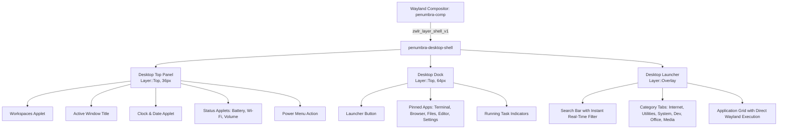

# Penumbra Desktop Convergence Shell Architecture

## Overview

The Penumbra Desktop Convergence Shell (`penumbra-desktop-shell`) provides an adaptive, high-performance desktop user interface for external monitors connected via USB-C DisplayPort Alt Mode or HDMI docks. Built using **Slint UI** and the custom zero-winit [`layer-shell-slint`](file:///home/nyl/coding/Penumbra-Shell/crates/layer-shell-slint) backend, it provides a native Wayland desktop shell without the overhead of heavy WGPU or Iced runtimes.

---

## Component Architecture



---

## 1. Zero-Winit Output Binding

Layer surfaces are bound per-output via `LayerConfig::with_output`:
- When `--output <CONNECTOR>` is passed (e.g. `DP-1` or `HDMI-A-1`), [`layer-shell-slint`](file:///home/nyl/coding/Penumbra-Shell/crates/layer-shell-slint) queries connected monitors through `smithay-client-toolkit`'s `OutputState`.
- When set to `"external"`, it automatically routes to the primary non-internal external display.
- Desktop surfaces reserve workspace margins via `exclusive_zone` so floating XDG desktop windows automatically maximize cleanly between the top panel and the bottom dock.

---

## 2. Dynamic Overlay Input Region Toggle

To ensure 0% idle CPU and eliminate phantom pointer blocks:
- The Modal Application Launcher resides on `Layer::Overlay`.
- When closed, [`layer_shell_slint::sync_input_region`](file:///home/nyl/coding/Penumbra-Shell/crates/layer-shell-slint/src/platform.rs) collapses its input geometry to $0 \times 0$ with `opacity: 0.0`. Clicks and pointer movements pass straight through to desktop windows underneath.
- When opened (via the Top Panel "Apps" button or Dock launcher), the input region expands fullscreen with `KeyboardInteractivity::OnDemand`. Typing or pressing `Escape` immediately interacts with or closes the launcher.

---

## 3. CLI Usage

```bash
penumbra-desktop-shell [OPTIONS]

Options:
  -o, --output <OUTPUT>          Designated output connector (e.g. "DP-1", "HDMI-A-1", "external") [default: external]
      --panel-only               Run only the Top Desktop Panel
      --dock-only                Run only the Bottom Desktop Dock
      --launcher-only            Run only the Centered Desktop Launcher
      --workspaces <WORKSPACES>  Total number of desktop workspaces [default: 4]
  -h, --help                     Print help
```
