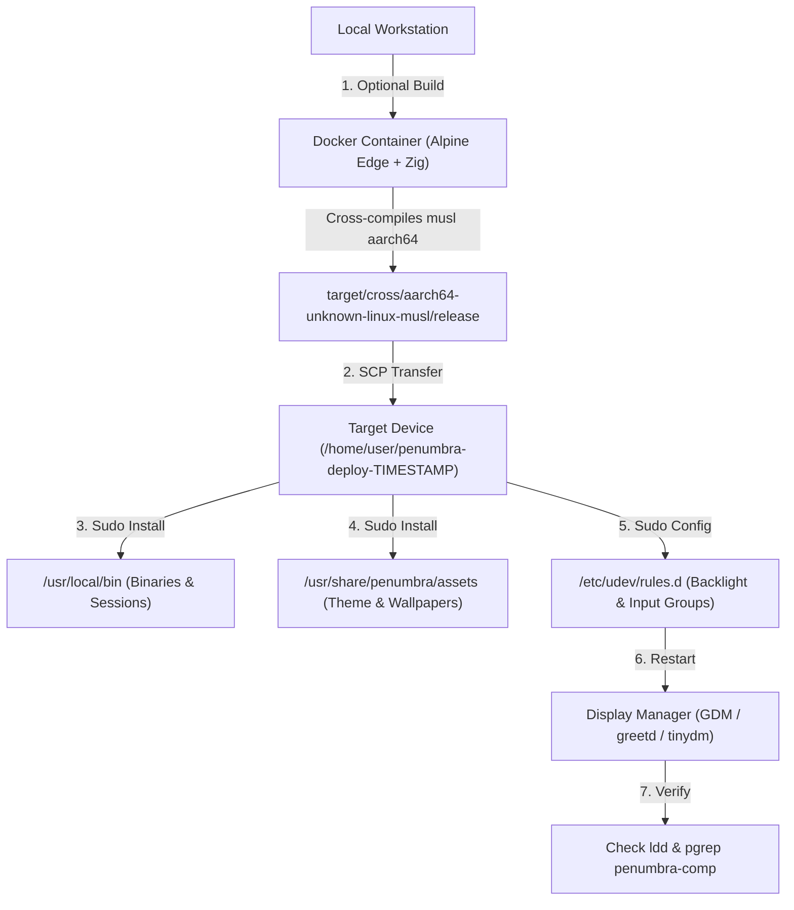

# Penumbra Mobile DE — Deployment Guide (`deploy.sh`)

This guide documents the architecture, options, lifecycle, and troubleshooting procedures for [`scripts/deploy.sh`](file:///home/nyl/coding/Penumbra-Shell/scripts/deploy.sh), the automated deployment tool for the Penumbra Mobile Desktop Environment on Linux phones (such as the Fairphone 4 running postmarketOS, Alpine, or Debian-based mobile distributions).

---

## 1. Overview

`deploy.sh` orchestrates the complete end-to-end pipeline required to test, cross-compile, stage, install, and restart the Penumbra desktop environment on a target mobile device connected via USB or Wi-Fi.



---

## 2. Prerequisites

### Local Host Workstation
1. **Docker**: Required when using `--build` to compile `aarch64-unknown-linux-musl` binaries using `Dockerfile.aarch64-alpine`.
2. **`sshpass`**: Required for automated SSH password authentication (install via `sudo apt install sshpass` or distribution equivalent).
3. **OpenSSH Client**: `ssh` and `scp` for communication.

### Target Phone Device
1. **Network Connectivity**: Connected via USB networking (RNDIS / CDC-NCM, default IP: `172.16.42.1`) or local Wi-Fi.
2. **SSH Server**: Running on port 22 with password or key authentication enabled.
3. **Sudo Privileges**: User account on the phone requires sudo access for installing binaries to `/usr/local/bin` and updating udev rules.

---

## 3. CLI Options & Syntax

```bash
./scripts/deploy.sh [OPTIONS]
```

| Flag | Long Option | Description | Default |
|---|---|---|---|
| `-b` | `--build` | Cross-compile ARM64 Alpine release binaries in Docker before deploying | Disabled |
| | `--no-build`, `--deploy-only` | Skip compilation and deploy existing pre-built release binaries | Enabled |
| | `--no-restart`, `--skip-restart` | Do not restart the display manager / session after installation | Restart enabled |
| | `--status` | Query phone reachability, uptime, display manager, battery, and active Penumbra processes | N/A |
| | `--logs` | View recent session and display manager logs on the device | N/A |
| | `--ip <ADDRESS>` | Override target phone IP address | `172.16.42.1` |
| | `--user <USER>` | Remote SSH username on the phone | `user` |
| | `--password <PASS>` | Remote SSH password | `1` |
| | `--sudo-pass <PASS>` | Remote sudo password for installation | `1` |
| `-h` | `--help` | Display usage synopsis | N/A |

---

## 4. Environment Variables

All parameters can be configured via environment variables for non-interactive scripting:

| Variable | Description | Default Value |
|---|---|---|
| `DEVICE_IP` | IP address of the target mobile device | `172.16.42.1` |
| `DEVICE_USER` | SSH user on the target device | `user` |
| `DEVICE_PASSWORD` | SSH password for the remote user | `1` |
| `SUDO_PASSWORD` | Sudo password for privilege escalation | `1` |
| `SESSION_MANAGER` | Display manager behavior (`auto`, `gdm`, `greetd`, `tinydm`) | `auto` |

---

## 5. Deployment Lifecycle Step-by-Step

### Step 1: Optional Cross-Compilation (`--build`)
When invoked with `--build`:
1. Executes [`scripts/build-arm64-alpine.sh`](file:///home/nyl/coding/Penumbra-Shell/scripts/build-arm64-alpine.sh).
2. Builds the Docker builder image based on [`Dockerfile.aarch64-alpine`](file:///home/nyl/coding/Penumbra-Shell/Dockerfile.aarch64-alpine).
3. Invokes `cargo zigbuild --target aarch64-unknown-linux-musl --release` for all workspace components, compiling `penumbra-comp` with `--features native-drm`.
4. Outputs statically linked musl binaries to `target/cross/aarch64-unknown-linux-musl/release/`.

### Step 2: Binary Validation
The script verifies that all canonical workspace binaries are present in the release folder:
- [`penumbra-comp`](file:///home/nyl/coding/Penumbra-Shell/crates/penumbra-comp) (DRM Wayland compositor)
- [`penumbra-shell`](file:///home/nyl/coding/Penumbra-Shell/crates/penumbra-shell) (Consolidated SystemUI runtime with `--systemui`)
- [`penumbra-top-bar`](file:///home/nyl/coding/Penumbra-Shell/crates/penumbra-shell/src/bin/top_bar.rs)
- [`penumbra-homescreen`](file:///home/nyl/coding/Penumbra-Shell/crates/penumbra-shell/src/bin/homescreen.rs)
- [`penumbra-nav-bar`](file:///home/nyl/coding/Penumbra-Shell/crates/penumbra-shell/src/bin/nav_bar.rs)
- [`penumbra-settings`](file:///home/nyl/coding/Penumbra-Shell/crates/penumbra-settings)
- [`penumbra-keyboard`](file:///home/nyl/coding/Penumbra-Shell/crates/penumbra-keyboard)
- [`penumbra-greeter`](file:///home/nyl/coding/Penumbra-Shell/crates/penumbra-greeter)

### Step 3: Remote Staging
An isolated remote directory (`~/penumbra-deploy-<timestamp>`) is created on the phone to stage:
- Binaries (`staging_dir/bin/*`)
- Session scripts (`penumbra-session`, `penumbra-nested-session`, `penumbra-native-session`)
- Wayland session definitions (`penumbra.desktop`, `penumbra-settings.desktop`, `penumbra-keyboard.desktop`)
- System assets and wallpapers (`staging_dir/assets/*`)

### Step 4: Installation & System Permissions
The script runs a root install script via `sudo`:
1. Installs binaries to `/usr/local/bin/` with `0755` permissions.
2. Installs Wayland session definitions to `/usr/share/wayland-sessions/` and applications to `/usr/share/applications/`.
3. Copies assets to `/usr/share/penumbra/assets/`.
4. Sets up udev backlight permissions (`/etc/udev/rules.d/90-backlight.rules`) and adds the phone user to `video`, `input`, and `audio` groups.
5. Cleans up the staging directory.

### Step 5: Session Restart
If restart is enabled (default):
- Checks for active display managers in order: `gdm` $\to$ `greetd` $\to$ `tinydm`.
- Restarts the display manager via `systemctl restart <service>`.
- If no display manager is active, terminates stale `penumbra-comp` sessions to allow automatic respawn.

### Step 6: Post-Deployment Verification
1. Executes `ldd /usr/local/bin/penumbra-comp` on the phone to guarantee all shared libraries resolve cleanly.
2. Waits 3 seconds and verifies that `penumbra-comp` is running (`pgrep -la penumbra-comp`).

---

## 6. Common Usage Recipes

### Fast Deploy (Pre-built Binaries)
```bash
./scripts/deploy.sh
```

### Full Cross-Compile & Deploy
```bash
./scripts/deploy.sh --build
```

### Inspect Phone Status & Processes
```bash
./scripts/deploy.sh --status
```

### View Live Logs on Device
```bash
./scripts/deploy.sh --logs
```

### Deploy to Custom IP
```bash
./scripts/deploy.sh --ip 192.168.1.150 --user mobile --password mypass
```

---

## 7. Troubleshooting

| Symptom | Root Cause | Fix |
|---|---|---|
| `Cannot connect to user@172.16.42.1` | Phone USB networking is disabled or IP differs | Enable USB tethering on phone or check `ip route`. Verify IP with `ping 172.16.42.1`. |
| `sshpass is required for password authentication` | Tool not installed on host | Install with `sudo apt install sshpass` or `apk add sshpass`. |
| `Missing binary: target/cross/...` | Binaries haven't been cross-compiled yet | Run `./scripts/deploy.sh --build` to cross-compile via Docker. |
| `penumbra-comp has unresolved shared libraries` | Missing system package on phone (e.g. libinput, mesa-gbm) | Check `ldd` output reported by the script and install missing `.so` on device. |
| Black screen after restart | DRM permissions or display manager issue | Run `./scripts/deploy.sh --logs` to check session log and `journalctl -u gdm`. |
